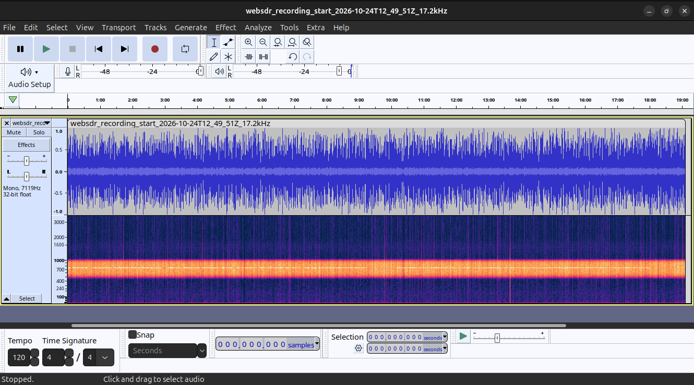

This recording IS NOT a real reception from my equipment. This sound was recorded from http://websdr.ewi.utwente.nl:8901/

Youtube live from Alexander SAQ Grimeton Friendship Association Alexander SAQ Grimeton Friendship Association SAQ Grimeton historical VLF transmitter on UN-Day Oct 24th 2026 - 12:20 UTC 
https://www.youtube.com/watch?v=qcw60OCIosU

Grimeton Radio Station, Varberg - UNESCO World Heritage
https://whc.unesco.org/en/list/1134

#### Spectrum

#### Gemini AI Overview

Na escala de reportagem de sinais do radioamadorismo (conhecida como código RST), a legibilidade de uma transmissão é qualificada pela letra R (Readability), que varia exatamente de 1 a 5.
Para a sua gravação, a nota ideal é R3 (Legível com dificuldade substancial) ou R2 (Legível de vez em quando) se o chiado sumir com partes do sinal. Se você consegue entender todos os pontos e traços apesar do chiado forte, o seu reporte de legibilidade é 3.
Abaixo está o guia oficial da escala de 1 a 5 para você classificar sua recepção:
Escala R (Readability / Legibilidade)

    1 — Incompreensível: Impossível entender qualquer coisa.
    2 — Mal legível: Distinguem-se palavras ou sinais isolados de vez em quando.
    3 — Legível com dificuldade: Sinais inteligíveis, mas exigem muito esforço devido ao ruído/chiado (o caso da sua gravação).
    4 — Legível: Praticamente sem dificuldade, sinal claro.
    5 — Perfeitamente legível: Sinal perfeitamente limpo e claro.

Completando o seu reporte (RST)
Como você está ouvindo um sinal telegráfico (CW/Código Morse), o reporte completo em um cartão QSL é composto por três números (R-S-T):

    R (Legibilidade): De 1 a 5 (No seu caso, 3).
    S (Sinal/Intensidade): De 1 a 9. Mede a força do "beep" em relação ao ruído. Se o chiado está muito forte e o beep está mergulhado nele, a intensidade costuma ser baixa (ex: 3 ou 4).
    T (Tonalidade): De 1 a 9. Avalia a pureza do som do beep. Se o tom do CW for limpo e musical, sem distorção ou engasgos, a nota é 9.

Exemplo de preenchimento para o seu caso:
Se o sinal está difícil mas entendível (3), o volume do beep é fraco/médio (4) e o tom do som é puro (9), o seu reporte QSL será RST 349.
<!-- Se você quiser, posso ajudar a decodificar o áudio se você transcrever os pontos e traços, ou te ajudar a identificar as siglas internacionais usadas em cartões QSL. Como prefere prosseguir? -->

##### Para saber mais

English
https://www.megger.com/en-us/et-online/march-2020/have-you-ever-heard-of-the-alexanderson-alternator

Portuguese
https://www.megger.com/pt-br/et-online/march-2020/have-you-ever-heard-of-the-alexanderson-alternator
